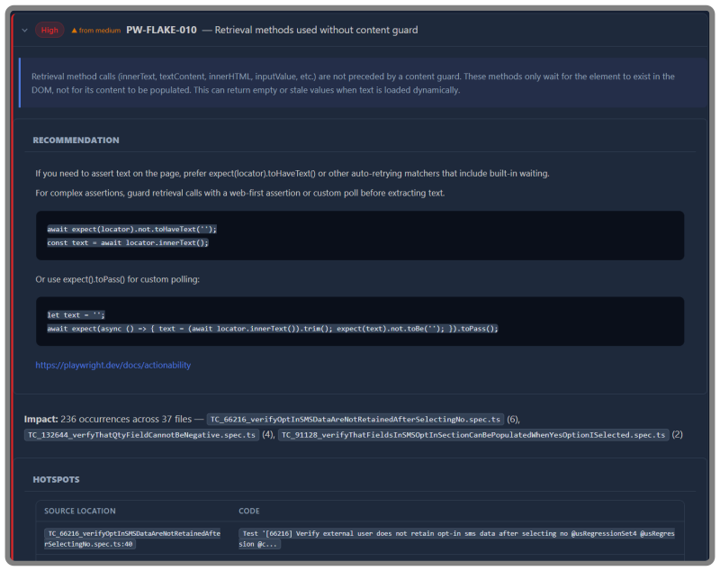
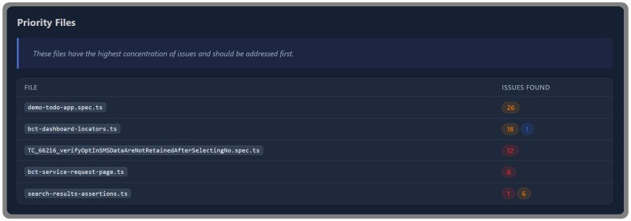
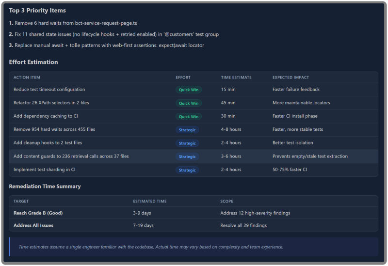

<p align="center">
  
</p>

<h3 align="center">
  Static analysis for Playwright, Cypress, and Selenium test suites.<br/>
  Find out <em>why</em> your tests are broken, not just that they are.
</h3>

<p align="center">
  <a href="#quick-start">Quick Start</a> &middot;
  <a href="#output-formats">Output</a> &middot;
  <a href="#cli-reference">CLI Reference</a> &middot;
  <a href="#github-action">GitHub Action</a> &middot;
  <a href="docs/RULES.md">Rules</a> &middot;
  <a href="#license">License</a>
</p>

<p align="center">
  <a href="https://github.com/Scantrix/scantrix/actions/workflows/ci.yml">
    
  </a>
  <a href="https://www.npmjs.com/package/scantrix">
    
  </a>
  <a href="#license">
    
  </a>
</p>

---

Most tools tell you a test failed. **Scantrix tells you why your entire approach is failing** and exactly what to do about it.

By correlating code patterns, framework design, and CI configuration across **87 detection rules**, Scantrix surfaces root causes behind flaky tests, unstable pipelines, and hard-to-scale test suites. No test execution. No credentials. No file modifications. Just answers.

### EXAMPLE FINDING


### RISK OVERVIEW



### RECOMMENDED ACTIONS




## What Scantrix Diagnoses

**Flaky test root causes.** Not just which tests fail, but exactly why they fail and what will actually fix them.

**Framework-level design debt.** Structural patterns that silently destabilize entire test suites before anyone realizes something is wrong.

**CI configuration risks.** The environmental factors making your pipeline unpredictable run to run.

**Blast radius of bad patterns.** One anti-pattern can affect hundreds of tests. Scantrix quantifies that exposure so you know where to act first.

**Execution waste.** Where time is being burned in your pipeline and the precise changes that recover it.


## What Scantrix Does NOT Do

Scantrix is a read-only static analysis tool. <br>
-  It does not execute your tests <br>
-  It does not modify any files in the target repository <br>
-  It does not make network connections beyond the local filesystem <br>
-  It does not require credentials and access tokens of any kind </br>

Point it at a repo and it does its job cleanly.<br>

## Quick Start

```bash
# Install dependencies
npm install

# Build
npm run build

# Scan a repository
node dist/cli.js /path/to/repo --out ./audit-out

# Or use the shorthand (builds + scans)
npm run audit -- /path/to/repo --out ./audit-out
```

## Output Formats

Every scan produces an **overall risk grade (A through F)** alongside severity-bucketed findings, ready for dashboards, PR comments, or executive reporting.

| Format | File | Description |
|--------|------|-------------|
| Markdown | `audit_summary.md` | Primary report with executive-grade findings and hotspots |
| HTML | `audit_summary.html` | Styled report for browser viewing |
| JSON | `findings.json` | Machine-readable findings array |
| SARIF | `audit.sarif` | Native GitHub Code Scanning and Azure DevOps support — findings appear directly in the Security tab |
| Email | `audit_email.html` | Email-ready HTML summary |

Use `--format` to select specific formats:

```bash
node dist/cli.js /path/to/repo --out ./audit-out --format md,json,sarif
```


## CLI Reference

```
scantrix <repoPath> [options]
scantrix init [dir]
```

### Scan Options

| Flag | Description | Default |
|------|-------------|---------|
| `--out <dir>` | Output directory for reports | `./audit-out` |
| `--format <list>` | Comma-separated formats: `md,html,json,sarif,email` | all |
| `--config <path>` | Path to `.auditrc.json` config file | auto-detected |
| `--updates` | Check npm registry for outdated dependencies | off |
| `--diff <path>` | Explicit baseline `findings.json` for comparison | auto |
| `--no-trend` | Disable automatic snapshot saving | off |
| `--json-path <path>` | Write canonical `ScanResult` JSON to this path | — |

### Environment Variables

| Variable | Description |
|----------|-------------|
| `SCANTRIX_JSON_PATH` | Write canonical results JSON to this path |

### Init Subcommand

```bash
# Create a starter .auditrc.json in the target repo
node dist/cli.js init /path/to/repo
```

## Configuration

Create an `.auditrc.json` in the target repository to customize behavior:

```bash
node dist/cli.js init /path/to/repo
```

The config file supports rule overrides (disable rules, adjust severity) and scan options. See [CLI Architecture](docs/CLI_ARCHITECTURE.md) for details.

## GitHub Action

Use Scantrix in CI with the provided composite action:

```yaml
- uses: your-org/scantrix@v1
  with:
    repo-path: "."
    output-dir: "./scantrix-out"
    format: "md,html,json,sarif"
    post-comment: "true"    # Post summary on PRs
    fail-on-high: "true"    # Block merges with high-severity findings
```

### Action Inputs

| Input | Description | Default |
|-------|-------------|---------|
| `repo-path` | Path to repository to scan | `.` |
| `output-dir` | Directory for audit artifacts | `./scantrix-out` |
| `config-path` | Path to `.auditrc.json` | — |
| `format` | Output formats (comma-separated) | `md,html,json,sarif` |
| `check-updates` | Check for outdated dependencies | `false` |
| `post-comment` | Post summary comment on PRs | `true` |
| `fail-on-high` | Fail if high-severity findings exist | `false` |

### Action Outputs

| Output | Description |
|--------|-------------|
| `findings-count` | Total number of findings |
| `high-count` | Number of high-severity findings |
| `medium-count` | Number of medium-severity findings |
| `low-count` | Number of low-severity findings |
| `risk-grade` | Overall risk grade (A through F) |
| `report-path` | Path to generated report directory |

## Documentation

- [Rules Reference](docs/RULES.md) — all 87 finding rules with severity and description
- [CI Integration](docs/CI_INTEGRATION.md) — CI pipeline setup and quality gates
- [CLI Architecture](docs/CLI_ARCHITECTURE.md) — module diagram and data flow
- [Security](docs/SECURITY.md) — security model and threat considerations
- [Finding Reference](FINDING_REFERENCE.md) — complete finding ID catalog

## Contributing

Contributions are welcome. Please open an issue to discuss proposed changes before submitting a pull request.

```bash
# Run the test suite
npm test

# Run tests in watch mode
npm run test:watch
```

## License

[AGPL-3.0](LICENSE) — Copyright (c) 2026 Shawn Tamez / Scantrix
